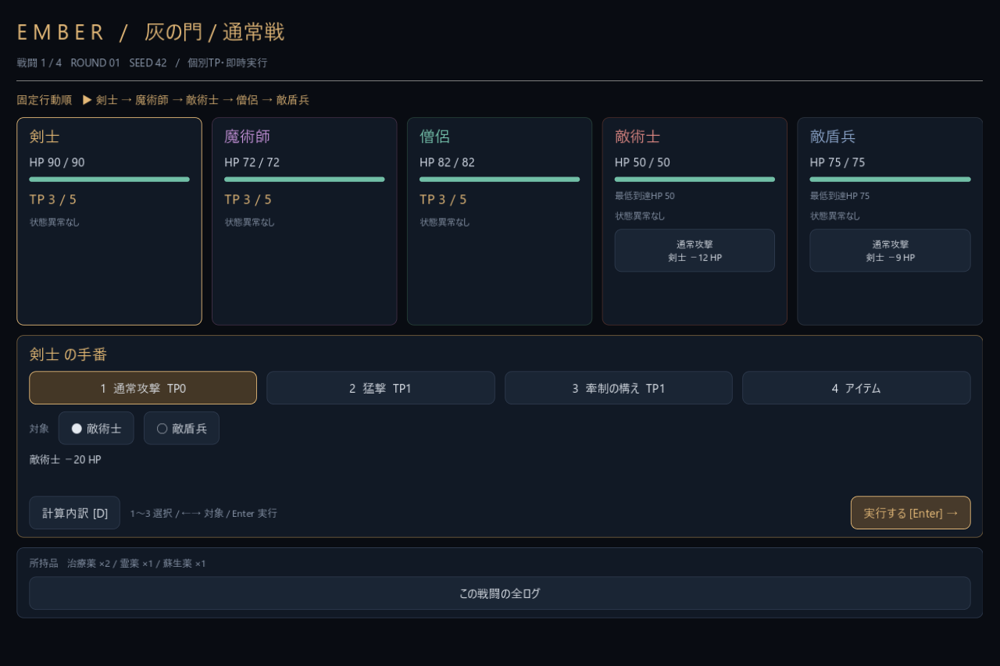

# EMBER / 残り火の旅 — Ver.0.2

Godot 4.6 / GDScript製の短いローグライトRPGです。3人のパーティで通常戦2回、有限イベント、強敵、最奥ボスに挑みます。敵の予告を読み、個別TP・HP・装備・アイテムを次戦へ持ち越して戦います。



## 起動

```powershell
git clone https://github.com/WataruShimomura/ember-roguelite.git
cd ember-roguelite
git switch feature/v0.2-roguelite-loop
```

[Godot 4.6通常版](https://godotengine.org/download/archive/4.6-stable/) を用意し、`project.godot` を開いて **F5**。Windows用の実行ファイル2個を `tools/` に置けば **`Play.cmd`** でも起動できます。この作業フォルダーには配置済みです。Godot本体はGitに含めません。[配置方法](tools/README.md)。

## 遊び方

1. 出撃準備で速攻・継戦のプリセット、装備各2枠、冒険シードを選択します。
2. 通常戦→報酬3択→通常戦→報酬3択→祭壇2択→強敵→報酬3択→ボスと進みます。
3. 勝利後はHP/TPと残アイテムを持ち越し、入手した装備を交換できます。全滅で冒険終了です。
4. 冒険リザルトで各戦のHP/TP推移、計算内訳、装備・報酬・イベント履歴を振り返り、再挑戦できます。

| 操作 | 内容 |
|---|---|
| マウス / Tab・Enter | ボタン・装備の選択 |
| 1〜3 | 通常攻撃・固有スキルA・固有スキルB |
| 4 | アイテム一覧を開閉。Tabまたはマウスで選択 |
| ← / → | 対象切替 |
| Enter | 現在の行動を即時実行 |
| D | 計算内訳。敵の予告ボタンでも確認可能 |
| Esc | 内訳を閉じる / 通常画面では通常攻撃へ戻る |

共通防御コマンドはありません。剣士の「牽制の構え」は攻撃・効果量低下・自身の軽減を兼ねる固有スキルです。通常攻撃はTP0、無条件のTP獲得なし。有料スキルのコスト軽減は最低1TPです。

吸収は「その敵の最低到達HPを更新した分」が原資。敵が回復したHPを再び削っても吸収できません。複数装備は同じ新規削減HPを参照して個別に切り捨てます。反撃は再反撃を起こしません。

## 編集する場所

| ファイル | 内容 |
|---|---|
| `data/content.json` | 4能力、キャラ初期TP、スキル、装備、火傷、敵AI、4戦の編成候補、報酬、アイテム、イベント、プリセット |
| `data/visuals.json` | 表示名・説明・配色・キャラ画像・フォント・背景・BGM |
| `core/run_state.gd` / `core/run_manager.gd` | 周回状態、戦闘開始/終了取込、報酬・装備交換・イベント、用途別乱数、結果 |
| `core/battle_state.gd` / `core/battle_engine.gd` | 個別HP/TP・最低到達HP、手番・予告・入力検証 |
| `core/action_calculator.gd` / `core/effect_resolver.gd` | 副作用なしの計算・吸収・反撃予測、効果の実適用 |
| `core/content_catalog.gd` / `core/enemy_intent_policy.gd` | 定義と参照の検証、予告方針 |
| `core/result_aggregator.gd` | 戦闘ログからの集計 |
| `ui/*_view.gd` | 出撃・戦闘・報酬/イベント・装備交換・結果の各画面 |

画像を `assets/` などへ配置し、`data/visuals.json` の `units.<ID>.portrait` を `res://assets/knight.png` などに変更します。`font` / `background` / `bgm` も差し替え可能です。未設定・存在しない素材は文字・図形・システムフォント・無音にフォールバックします。戦闘ロジックの変更は不要です。独立したSE・アイコン再生はありません。

ロード時には不明なスキル・敵・装備効果・報酬参照等を検証します。既存の効果をデータで組み合わせられますが、新しい種類の効果には計算/適用ハンドラの追加が必要です。

## テストと記録

```powershell
.\Test.ps1          # 戦闘・周回テスト + ヘッドレスUI + ログ保存
.\Test.ps1 -Render  # 実画面を描画、9画面のPNGも生成
.\Test.ps1 -Godot 'C:\path\godot_console.exe' -Render
```

Godot 4.6 / Windowsで **戦闘・周回549検証、描画ありUI23検証が成功**。速攻・継戦の両ビルドで4戦クリア。テストの入力方針・実測・未確認事項は [Ver.0.2テスト報告](docs/v0.2/TEST_REPORT.md) を参照してください。

冒険リザルトの「冒険ログJSONを保存」で `user://last_run.json` に全戦闘イベント、HP/TP、装備、報酬、イベント、シード、参照指示コミットを保存します。Windows通常時は `%APPDATA%\EmberBattlePrototype\last_run.json`、画面にも実際の保存先を表示します。再保存は上書きです。途中セーブ/再開機能はありません。

## 設計と版の履歴

- [実装報告・クラス責務・調整数値](docs/v0.2/IMPLEMENTATION_REPORT.md)
- [未確定事項の採用判断](docs/v0.2/DECISIONS.md)
- [テスト結果・手動確認手順](docs/v0.2/TEST_REPORT.md)
- 指示元: [`instructions/v0.2` の固定コミット c2921672](https://github.com/WataruShimomura/ember-roguelite/tree/c2921672a4679ecc9e5c9e439c98278b56960db8/instructions/v0.2)
- Ver.0.1: コミット `9e8461baf2a2b1ab35ada23dd896638941671d65` で復元可能。旧 [設計判断](DECISIONS.md)・[検証報告](TEST_REPORT.md) は当時の記録として維持しています。

恒久強化、図鑑、複雑な分岐マップは含めていません。数値は仮調整です。人手による長時間プレイ、Windows以外、独立エクスポート、差し替え素材付きの動作は未検証です。配布エクスポート時は追加ファイルフィルターに `*.json` を含めてください。

Git管理対象はソース・JSON・シーン・UID・資料・テスト。Godot本体、`.godot/`、`tests/artifacts/`、ビルド、端末固有設定は除外します。ライセンスは未設定です。
